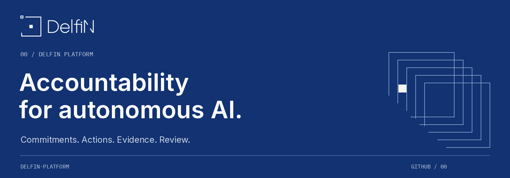

# DelfiN

DelfiN is building an accountability layer for autonomous AI: connect commitments to observable actions, inspect the evidence, and review the result.

[Explore DelfiN](https://delfinplatform.tech/)

## From commitments to review

**01 · Commitments** — state the rules an agent is expected to follow.  
**02 · Actions** — make relevant execution observable.  
**03 · Evidence** — retain the records needed to examine what happened.  
**04 · Review** — distinguish automated findings from human decisions.

We develop the product, verification demos and shared design language in this organization.
